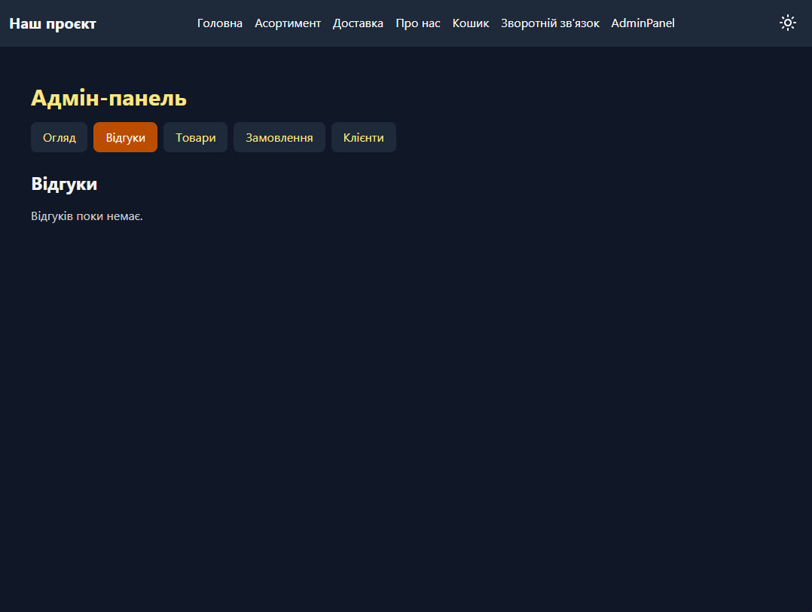
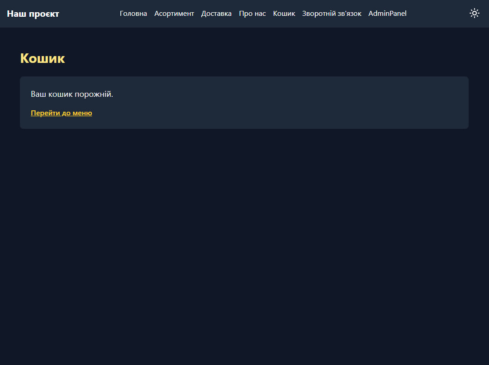
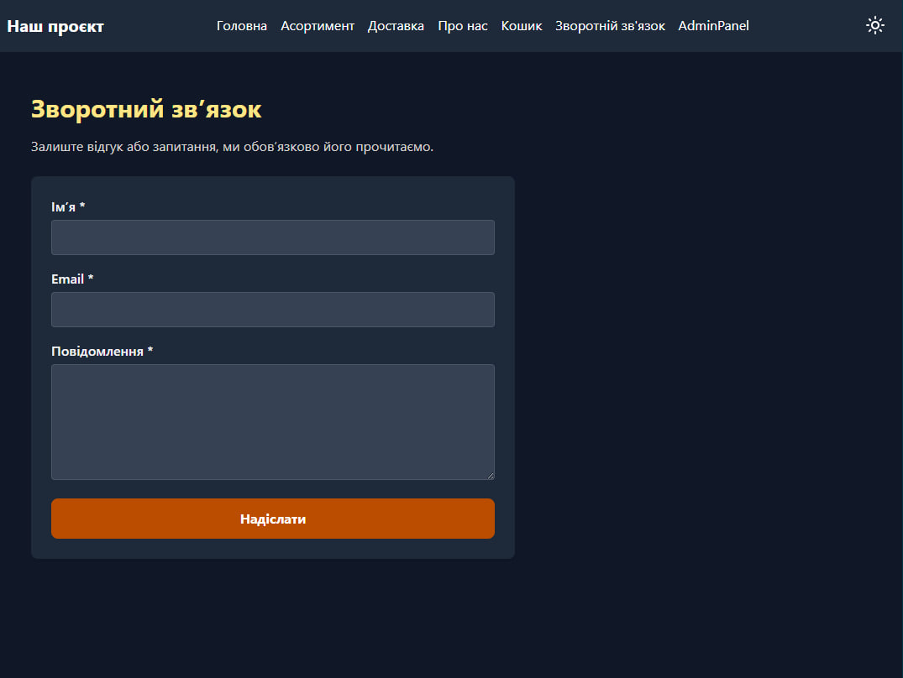

# Звіт до лабораторної роботи 04. Робота з базою даних у Flask-проєкті

**ПІБ:** Кубський Максим Сергійович
**Група:** ІПЗ-21
**Склад команди:**
- Систалюк Артем: каркас проєкту, клієнти
- Кубський Максим: частина А (відгуки та кошик)
- Марчук Максим: частина Б (товари та пошук)
- Мельник Віталій: частина В (замовлення та промокоди)

**Тема проєкту:** кав'ярня з десертами

## Особистий внесок

Я виконав частину А: відгуки та кошик (гілка `feature/feedback`).

**Відгуки** (`routes/feedback.py`, `templates/feedback.html`, `templates/admin/feedback.html`):

- сторінка `/feedback` (`feedback.feedback_form`): `GET` показує форму, `POST` зберігає відгук у таблицю `feedback`;
- перевірка даних: ім'я, email і повідомлення не порожні, email містить `@`; помилки показуються під відповідними полями, введені значення зберігаються; після успіху `flash` і перенаправлення (шаблон POST-Redirect-GET);
- адмінка `/admin/feedback` (`feedback.admin_list`): список відгуків, найновіші першими;
- видалення відгуку кнопкою з методом POST (`feedback.admin_delete`) із `flash`-повідомленням.

**Кошик** (`routes/cart.py`, `templates/cart.html`):

- `POST /cart/add/<product_id>` (`cart.add_to_cart`): перевіряє, що товар існує й `is_available = 1`, додає його в `session['cart']` або збільшує кількість;
- сторінка `/cart` (`cart.view_cart`): таблиця з назвою, ціною, кількістю, сумою рядка та загальною сумою; товари, які зникли або стали недоступними, прибираються з кошика із повідомленням;
- зміна кількості (`cart.update_cart`, кількість 0 видаляє позицію) і видалення позиції (`cart.remove_from_cart`), обидві через POST;
- порожній кошик показує повідомлення з посиланням на меню, кнопка «Оформити замовлення» веде на `orders.checkout`.

Усі SQL-запити параметризовані (`?`), зміни даних робляться через `execute_db`. Шаблони підтримують темну тему (`dark:`).

**Мої коміти:** (https://github.com/StarlicLV/lab04-team-project/commits/feature/feedback)

## Схема бази даних

База даних SQLite, схема описана у файлі schema.sql. Таблиць п'ять.

Таблиця	Поля	Призначення
feedback	id (PK), name, email, message, created_at	відгуки відвідувачів
products	id (PK), name, description, price (≥ 0), category, is_available (0 або 1)	товари меню
customers	id (PK), name, phone (UNIQUE), email, created_at	клієнти
orders	id (PK), customer_id (FK), status, address, comment, total, created_at	замовлення
order_items	id (PK), order_id (FK), product_id (FK), quantity (> 0), price_at_order	позиції замовлення

Первинні ключі. У кожній таблиці це поле id типу INTEGER PRIMARY KEY AUTOINCREMENT, яке база заповнює сама.

Зв'язки.

customers 1 → N orders: один клієнт має багато замовлень (orders.customer_id → customers.id, ON DELETE RESTRICT: клієнта із замовленнями видалити не можна).
orders 1 → N order_items: одне замовлення містить багато позицій (order_items.order_id → orders.id, ON DELETE CASCADE: разом із замовленням видаляються його позиції).
products 1 → N order_items (order_items.product_id → products.id, ON DELETE RESTRICT: товар, який є в замовленнях, видалити не можна, його вимикають через is_available = 0).
Між orders і products виходить зв'язок «багато-до-багатьох», а таблиця order_items є сполучною.
Таблиця feedback з іншими не пов'язана.

Обмеження. status приймає лише new, preparing, delivering, done, cancelled. customers.phone унікальний. price_at_order зберігає ціну на момент замовлення, щоб зміна ціни товару пізніше не змінила старі замовлення.

 
 
 

## Труднощі й як їх вирішено

- Ключі в `session['cart']` після збереження стають рядками, тому в коді ключ завжди рядок (`str(product_id)`), а при читанні перетворюється через `int(...)`.
- Зміни всередині словника `session['cart']` Flask не помічає сам, тому після кожної зміни виставляється `session.modified = True`.
- Кількість із форми може бути не числом, тому вона розбирається з обробкою помилки й обмежена зверху.

## Висновки

Я навчився робити CRUD для таблиці в SQLite через параметризовані запити, зберігати кошик у сесії та будувати форми з перевіркою даних за шаблоном POST-Redirect-GET. Також я переконався, що зміни даних треба робити методом POST, а не посиланням.
