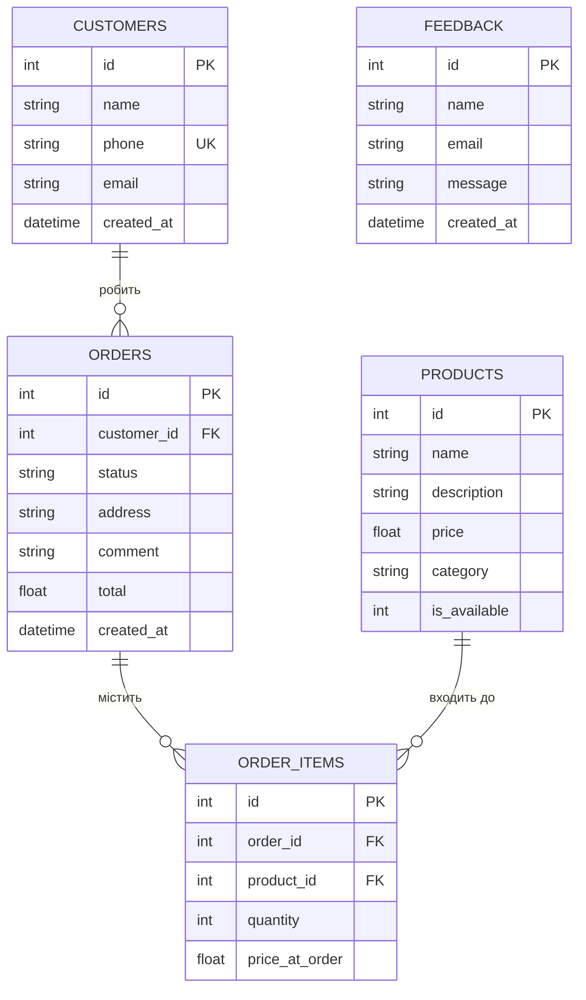
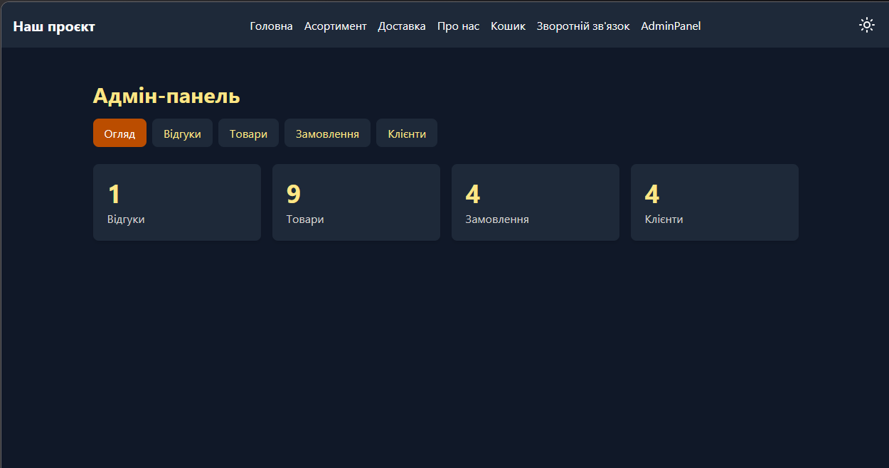
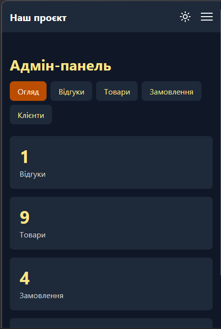
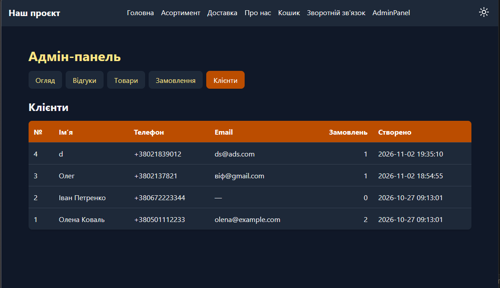

# Звіт до лабораторної роботи 04. Робота з базою даних у вебпроєкті

**ПІБ:** Систалюк Артем Васильович
**Група:** ІПЗ-21
**Склад команди:**
- Систалюк Артем: каркас проєкту, база даних, каркас адмін-панелі, клієнти
- Марчук Максим: відгуки, кошик
- Кубський Максим: товари, пошук і фільтрація
- Мельник Віталій: замовлення, статуси, промокоди

**Тема проєкту:** кав’ярня з десертами
**Репозиторій:** https://github.com/StarlicLV/lab04-team-project

## Особистий внесок

Лабораторна 4 є продовженням проєкту з лабораторної 3: сайт кав’ярні з десертами отримав базу даних SQLite та адмін-панель. Я підготував основу, на якій працювала вся команда: структуру проєкту, базу даних і каркас адмін-панелі.

**Репозиторій і організація роботи**

- Створив репозиторій `lab04-team-project` і підключив до нього проєкт. Репозиторій уже містив історію лабораторної 3, тому злив її зі своїми змінами, і коміти всіх учасників зберіглися.
- Розділив роботу між чотирма учасниками й описав її. Для команди підготував три частини, які учасники обирали самі, з чекліст-завданнями та критеріями готовності.
- Узгодив спільні угоди, на які спираються всі частини: імена endpoint-ів, формат кошика в сесії (`session['cart'] = {product_id: quantity}`), статуси замовлень, правила роботи з БД.
- Щоб учасники не редагували одні й ті самі файли, розбив маршрути на blueprint-и: кожен працює у власному файлі в папці `routes/`.

**База даних (`schema.sql`, `models.py`)**

Спроєктував схему з п’яти таблиць: `feedback`, `products`, `customers`, `orders`, `order_items`. Щоб дані були коректними, у схемі задано обмеження:

- первинні ключі (`INTEGER PRIMARY KEY AUTOINCREMENT`) і унікальний телефон клієнта (`UNIQUE`);
- перевірки `CHECK`: ціна не менша нуля, кількість більша нуля, статус замовлення лише з дозволеного списку, `is_available` лише 0 або 1;
- зовнішні ключі з різною поведінкою при видаленні: замовлення видаляє свої позиції (`ON DELETE CASCADE`), а клієнта із замовленнями й товар, що є в замовленнях, видалити не можна (`ON DELETE RESTRICT`). Для товарів передбачено вимкнення через `is_available`;
- у `order_items` зберігається `price_at_order`, тому зміна ціни товару не змінює суму старих замовлень.

У `models.py` зібрав спільний код для роботи з БД:

- `get_db()` відкриває з’єднання для поточного запиту й зберігає його в `g`, вмикає `row_factory = sqlite3.Row` (доступ до стовпців за іменами) і `PRAGMA foreign_keys = ON`, бо SQLite за замовчуванням не перевіряє зовнішні ключі;
- `close_db()` закриває з’єднання після запиту (підключено через `teardown_appcontext`);
- `query_db()` і `execute_db()` виконують запити лише з параметрами `?`; `execute_db()` сама викликає `commit()`;
- `init_db()` створює таблиці зі `schema.sql` (`CREATE TABLE IF NOT EXISTS`, тому безпечно викликати при кожному запуску) і додає тестові товари та клієнтів, якщо таблиці порожні.

Перевірив роботу обмежень: зовнішні ключі не дають видалити клієнта із замовленнями та товар, що є в замовленнях, видалення замовлення прибирає його позиції, а некоректний статус відхиляється перевіркою `CHECK`.

**Каркас застосунку та адмін-панель**

- `app.py`: шлях до бази, `SECRET_KEY` (потрібен для сесії й `flash`), підключення `close_db`, реєстрація blueprint-ів, створення таблиць при запуску.
- `routes/`: blueprint-и `admin`, `feedback`, `cart`, `shop`, `orders`, `customers` із заглушками, у яких закріплено імена endpoint-ів.
- `templates/admin/base_admin.html`: спільний шаблон адмін-панелі з вкладками (Огляд, Відгуки, Товари, Замовлення, Клієнти), підсвіткою активного розділу, показом `flash`-повідомлень і підтримкою темної теми.
- `routes/admin.py` і `admin/index.html`: головна сторінка адмін-панелі з кількістю записів у кожній таблиці (запити `SELECT COUNT(*)`).
- У `base.html` додав у меню посилання «Кошик», «Зворотний зв’язок» і «Адмін» через `url_for` із повними іменами endpoint-ів.
- У `.gitignore` додав `db.sqlite`, щоб у кожного учасника була власна локальна база, а бінарний файл не потрапляв у репозиторій.

**Клієнти (рівень 2)**

Для додаткової таблиці `customers` (клієнти кав’ярні) реалізував сторінку адмін-панелі `/admin/customers` (`routes/customers.py`, шаблон `admin/customers_list.html`):

- таблиця клієнтів із номером, ім’ям, телефоном, email і датою створення; новіші клієнти показуються першими (`ORDER BY c.id DESC`);
- у кожного клієнта виводиться кількість його замовлень. Для цього використано запит із `LEFT JOIN` таблиці `orders` та групуванням (`GROUP BY`, `COUNT(o.id)`). `LEFT JOIN` потрібен, щоб у списку були й клієнти без замовлень, для яких кількість дорівнює 0;
- якщо клієнтів немає, показується повідомлення, а відсутній email замінюється на «—»;
- шаблон наслідує `admin/base_admin.html`, підтримує темну тему, а таблиця розміщена в контейнері `overflow-x-auto`, тому на вузьких екранах не виходить за межі сторінки.

Запит виконується через спільну функцію `query_db()` із `models.py`. Сторінка підключена до адмін-панелі через вкладку «Клієнти» (`customers.admin_customers`).

**Коміти**

- Основні коміти: https://github.com/StarlicLV/lab04-team-project/commit/23b13531e31e1af32f24031df80159460e32707c#diff-dcfeaa5ac3dffd54264034760914588d92fc7395c81eaa9274715840dc28100b

## Схема бази даних

| Таблиця | Призначення | Ключі та зв’язки |
|---|---|---|
| `customers` | клієнти кав’ярні | `id` (PK), `phone` унікальний |
| `products` | товари меню | `id` (PK) |
| `orders` | замовлення | `id` (PK), `customer_id` → `customers.id` (RESTRICT) |
| `order_items` | позиції замовлення | `id` (PK), `order_id` → `orders.id` (CASCADE), `product_id` → `products.id` (RESTRICT) |
| `feedback` | відгуки відвідувачів | `id` (PK), без зв’язків з іншими таблицями |

Зв’язок «один-до-багатьох»: один клієнт має багато замовлень. Зв’язок «багато-до-багатьох» між замовленнями й товарами реалізовано через проміжну таблицю `order_items`: одне замовлення містить кілька товарів, а один товар може бути в багатьох замовленнях.

## Скріншоти

Адмін-панель, головна сторінка (темна тема):

Адмін-панель, мобільний вигляд:

Адмін-панель, розділ «Клієнти»:

## Труднощі та їх вирішення

- **Помилка `BuildError` у меню.** Після додавання посилань у `base.html` Flask видав `Could not build url for endpoint 'basket'`. Причина в тому, що endpoint маршрутів у blueprint-ах складається з імені blueprint-а та імені функції через крапку. Замінив назви на `cart.view_cart`, `feedback.feedback_form` та `admin.index`. Маршрути з `app.py` (`home`, `menu`, `about`, `delivery`) лишилися без префікса.
- **Розподіл роботи без конфліктів у Git.** Якби всі правили один `app.py` і один `admin.py`, злиття постійно ламалося б. Розбив маршрути на blueprint-и за учасниками, а в шаблоні адмінки заздалегідь додав вкладки для всіх розділів із заглушками. Так кожен додає свою частину у власному файлі, не торкаючись чужих.

## Висновки

У ході роботи я спроєктував реляційну базу даних кав’ярні з первинними й зовнішніми ключами, обмеженнями цілісності та зв’язком «багато-до-багатьох» через проміжну таблицю, а також навчився працювати з SQLite у Flask: параметризовані запити, `commit()` і закриття з’єднання для кожного запиту. Я підготував каркас і адмін-панель, на яких команда реалізувала свої частини, і розібрався, як розбити проєкт на blueprint-и та працювати в Git без конфліктів. Також я зрозумів, чому SQLite потребує явного ввімкнення перевірки зовнішніх ключів і як вибір між `CASCADE` та `RESTRICT` захищає дані.
